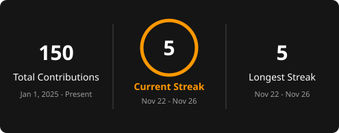

<h1 align="center">Hi, I'm Anjali Kumari 👋</h1>

  

  <b>Odoo & AI Developer Intern</b> @ Nixel Software Solutions 
  B.Tech Computer Engineering (AI & ML), Class of 2027 · Pune, India

  
  
  
  
  

> 🟢 **Open to full-time roles from 2027** · Odoo / ERP Developer · AI Engineer · SAP + AI

I build custom **Odoo 19** modules for purchase, inventory, HR and approval workflows, and I apply **AI** on top of business data. Currently learning **SAP BTP** to grow into SAP & AI roles.

## 🔭 What I'm working on
- Custom Odoo 19 modules for a chemicals distribution client (Simplinity project)
- Learning SAP BTP and AI from scratch, coming from an Odoo background
- Building AI projects at hackathons

## 💼 Experience

### Odoo & AI Developer Intern · Nixel Software Solutions Pvt. Ltd., Pune
*May 2026 – Nov 2026*

Across 3 client projects I built custom **Odoo 19** modules, worked from client requirement documents, and fixed issues found in client testing (UAT).

**1. ERP for an industrial chemicals & lubricants distributor --- Simplinity**
- **Purchase:** multi-vendor RFQ enforcement with director override, vendor document expiry alerts, three-way match on vendor bills
- **Inventory:** shelf-life and expiry workflows, material issue requests, delivery transporter handling, mandatory receipt verification
- **Approvals:** multi-stage approval engine with credit-limit checks, reused across Sales, Purchase and Material Issue Requests
- **HR:** KRA/KPI sheets with quarterly and annual reviews, role-based access and manager notifications
- **Sales and invoicing:** mandatory validations before order confirmation, GST invoice fields that auto-fetch dispatch details
- Built a **custom org chart** in a short time after the client was not satisfied with the standard one; praised by mentors
- Audited the codebase and fixed 7 bugs

**2. Estimation and costing system for a facade and glazing company --- Vermax**
- **Estimation flow:** estimate-to-quotation workflow with approval stages, using the shared approval engine
- **BOQ engine:** width, height and quantity on order lines automatically calculate area and billing quantity, tested against the client's real BOQ Excel files
- **Cost sheet and margin engine:** 10 cost heads with live margin, and Director approval required when margin falls below 15%
- **Roles:** access matrix for Sales, Estimator and Director, with an audit trail in the chatter
- **Revisions:** "Revise Estimation" button that creates versions (-E1, -E2), freezes the old one and shows the cost change
- BOQ fields carried through to manufacturing orders

**3. Field service reporting for a decontamination services company --- Decontamination**
- Built 3 client-branded PDF documents in Odoo Field Service: Service Report, Service Report (DTaT) and Service Feedback Form
- Matched the client's Word templates exactly, with the company logo pulled in automatically

**Tech:** Odoo 19, Python, ORM, XML views, QWeb, OWL, PostgreSQL, Git

## 🚀 Top projects
| Project | What it does | Stack |
|---|---|---|
| **Demand Forecasting & Inventory Optimization Engine** | ML engine that forecasts product demand and suggests stock levels, with a local LLM assistant that explains results in plain language. Connects to **Odoo 19** and creates a draft purchase order (RFQ) automatically through the JSON-2 API. Built for the IndiaAI FutureSkills Fellowship. | Python, scikit-learn, Ollama (llama3.2), Odoo 19 API |
| [Ask Anything: Voice RAG](https://github.com/Kumari-Anjali-12/hhg-voice-rag) | Voice-in, grounded-answer-out pipeline with five chunking strategies, FAISS hybrid retrieval and guardrails. Hacker House Goa 2026. | Python, FAISS, RAG, Docker |
| [FaceTheChain](https://github.com/Kumari-Anjali-12/FaceTheChain) | Face ID pipeline that finds a matching public post and verifies its hash on a Solidity smart contract. Hacker House Goa 2026. | Python, Computer Vision, Solidity, Web3 |
| **MedScribeAI** *(private, ongoing)* | Clinical documentation prototype with drug-interaction checks and an offline engine, built for Smart India Hackathon 2026 with Team AstraX. 46/46 tests passing. | React, TypeScript, Express |
| [Mental Health Mirror](https://github.com/Kumari-Anjali-12/mental-health-mirror) | Multi-modal emotion detection using NLP and computer vision. | Python, OpenCV, TensorFlow |
| **BTP Trial Explorer** *(in progress)* | Daily SAP BTP learning project with a Medium post per day. | SAP BTP, Cloud Foundry |

My Odoo work is in private company repositories, so I can't link it. Happy to talk through it.
<!-- When you make the Demand Forecasting repo public, turn its name into a link: [Name](https://github.com/Kumari-Anjali-12/demand-forecasting-engine) -->

## 🏆 Hackathons
- **Hacker House Goa 2026**: built Voice RAG and FaceTheChain
- **Smart India Hackathon 2026**: MedScribeAI with Team AstraX
<!-- Add results (winner, finalist, etc.) if you have them -->

## 🛠️ Tech

  

- **Odoo & ERP:** Odoo 19, ORM, XML views, QWeb, OWL, approval workflows
- **AI / ML:** Machine Learning, Deep Learning, NLP, Computer Vision, RAG
- **Data & Tools:** PostgreSQL, MySQL, Git, Docker

## 📊 GitHub stats

  

  
  

  

  <picture>
    <source media="(prefers-color-scheme: dark)" srcset="https://raw.githubusercontent.com/Kumari-Anjali-12/Kumari-Anjali-12/output/github-snake-dark.svg" />
    
  </picture>

## 🎓 Certifications & programs
- 🏅 **IndiaAI FutureSkills Fellowship** (in progress)
<!-- Add more lines like this: - 🏅 [Certificate name](link) · Issuer · Year -->

## ✍️ Latest from my blog
<!-- BLOG-POST-LIST:START -->
<!-- BLOG-POST-LIST:END -->

## 🌱 Currently learning
SAP BTP · AI/ML · Japanese (aiming for JLPT N5)

## 📫 Find me
- 🌐 Portfolio: [kumari-anjali-12.github.io/kumarianjali12.github.io](https://kumari-anjali-12.github.io/kumarianjali12.github.io/)
- 💼 LinkedIn: [anjali-kumari-ab0300292](https://www.linkedin.com/in/anjali-kumari-ab0300292)
- ✍️ Medium: [@Anjali-Kumari-26](https://medium.com/@Anjali-Kumari-26)
- 📧 kumarianjali5424@gmail.com

*Open to full-time roles where ERP development and AI work together.*
